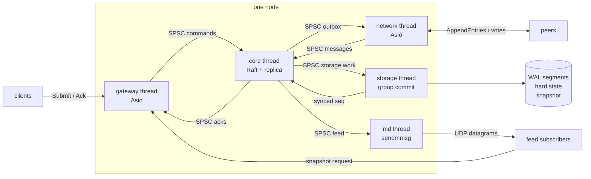

# Architecture

A 3-node replicated limit order book. Clients submit commands to the leader; the command is
replicated with Raft, applied to a deterministic matching engine on every node, and acknowledged
only once it is committed and applied. Every node also publishes the committed command stream as
a sequenced UDP feed.



## Threads

| Thread | Owns | Never does |
|---|---|---|
| core | `Raft`, the `Replica` (order book + sessions), the held-message queue | block, allocate per order, take a lock |
| network | peer sockets, frame decode, reconnects | touch Raft state |
| storage | `DiskStorage` (WAL, hard state, snapshot) | anything but write and sync |
| gateway | client sockets, ack routing | apply or propose itself |
| md | UDP socket, packing | wait for subscribers |

Threads talk only through single-producer single-consumer rings (`core/spsc.hpp`): cached indices
on separate 128-byte lines, acquire/release only, batch push and pop.

## Ordering rules

1. A Ready's hard state and entries go to the storage thread with a sequence number. Every reply
   in that Ready, and every committed entry it carries, is held until storage reports that number
   synced (Raft thesis 10.2.1: a vote or an acknowledged entry is durable before anything that
   depends on it leaves).
2. The leader's AppendEntries leave immediately; its own vote toward commit counts only after its
   fsync (`Raft::persisted`). A batch whose entries were replaced in the meantime reports nothing,
   checked by Log Matching on its last index and term.
3. Within one sync the hard state file is replaced before any entry is written, so a crash never
   keeps an entry from a term the node had not durably entered.
4. An ack leaves only after the command's entry is applied on the leader. Retries carry the same
   (session, seq); the replica answers a duplicate from the session cache with the original events.

## Storage

- WAL segments are preallocated, written with one `pwritev` per batch and made durable with
  `fdatasync`; truncation is an append of a lower index, compaction an append of a snapshot mark.
- On open, a record with an all-zero sector is a torn write: the log ends there and the tail is
  zeroed. Any other CRC failure is corruption and fails stop.
- Hard state and snapshot files are replaced with write, fsync, rename, fsync directory.

## Verification

| Layer | Tool | Where |
|---|---|---|
| protocol | TLA+ model of elections and AppendEntries, checked by TLC | `spec/`, `tlc.yml` |
| consensus | deterministic simulator: fake clock, network, disk; swarm fault schedules; invariant checker | `sim/`, 500 seeds per PR, 100,000 nightly |
| engine | replay of 10M commands built with clang and gcc must produce the same book hash | `replay-gate` |
| wire | libFuzzer over record, frame and Raft message decoders | `fuzz/` |
| threads | TSan over the whole suite | `tsan` |
| real IO | Docker chaos: kill, partition, latency, pause; WAL audit and Porcupine | `chaos/`, nightly |

## Replaying a failing seed

The simulator is a pure function of its seed, so any failure reproduces exactly:

```sh
cmake --preset release && cmake --build --preset release --target sim
build/release/tools/sim --seeds 4242 --verbose   # one seed with its fault schedule and trace
build/release/tools/sim --seeds 1..500            # the per-PR range
```

A chaos run keeps its nemesis schedule, client history and every node's data directory:

```sh
FAULTS=kill,partition SEED=7 chaos/run.sh && chaos/check.sh chaos/runs/kill,partition-7
```

## Layout

| Directory | Contents |
|---|---|
| `core/` | strong types, RNG, hashing, SPSC ring |
| `engine/` | order book, price ladder, order pool, sessions, snapshots |
| `codec/` | fixed-size command records, CRC32C |
| `consensus/` | sans-IO Raft: PreVote, CheckQuorum, pipelining, compaction, InstallSnapshot, recovery |
| `sim/` | deterministic simulator and checker |
| `io/` | frames, WAL, `DiskStorage`, storage thread, peer transport |
| `node/`, `gateway/`, `md/` | the node binary, client protocol, market data |
| `chaos/`, `bench/` | fault injection, history checks, load generation |
