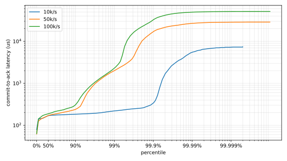
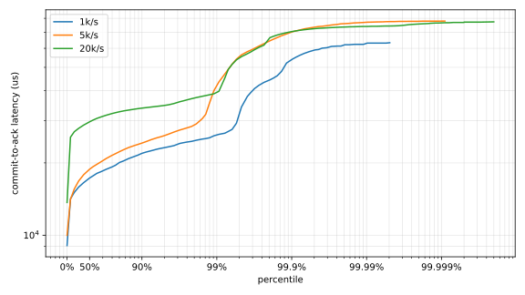

# Benchmarks

Every number here comes from `bench/report.sh` (microbenchmarks and replicated latency),
`bench/sweep.sh` and `bench/failover.py`, run from the same commit. Raw HdrHistogram output is in
[bench/](bench/).

## Host and method

- AMD Ryzen 7 7800X3D (Zen 4, 8 cores / 16 threads, 96 MB L3), 23 GB RAM, Ubuntu 24.04 VM on
  Linux 6.18. Virtualized: no `isolcpus`, and the hypervisor schedules the vCPUs, which shows up as
  millisecond outliers in the far tail.
- Release build: clang 18, `-O3 -flto=thin -march=native` for the microbenchmarks.
- The 3-node cluster runs as three local processes. With `--cpus` each node's core thread gets its
  own physical core, its network thread another, and its storage thread the core thread's SMT
  sibling; the load generator is pinned to the last core.
- All three nodes share one virtual disk, which sustains about 290-460 `fdatasync`/s. A real
  deployment gives each node its own disk, so the disk-backed numbers below are a lower bound;
  runs with `DATA_ROOT=/dev/shm` keep the WALs in memory to measure the software path alone.
- Latency is open loop: commands go out at fixed intervals and each is timed from when it was
  scheduled to go out until its ack (commit and apply on the leader) arrives, so a stall counts
  against every command scheduled behind it. Percentiles are from HdrHistogram at 3 significant
  digits.

## Single node

| Benchmark | Result |
|---|---|
| matching engine, 1M-command stream | 46.1M commands/s, 0 allocations, 5.3 MB book |
| per-command apply latency | p50 30 ns, p99 80 ns, p99.9 110 ns |
| record decode / encode | 383M/s / 159M/s |
| CRC32C (SSE4.2) | 12.9 GiB/s |
| command log replay | 131M commands/s |
| SPSC ring, two cores | 51M items/s single, 1.45G items/s in batches of 64, 118 ns round trip |
| WAL, 256-byte entries | 458 entries/s syncing each one; 54.7k entries/s with group commit (220 syncs/s) |
| peer transport, loopback | 1.50M AppendEntries/s, 0.68 writes per 1,000 frames |

## Replicated latency

Three nodes, pinned, open loop for 20 s after 2 s of warm-up, four pipelined sessions on the
leader. Every command was applied in every run.

WALs in memory (the software path):

| Offered rate | p50 | p99 | p99.9 | p99.99 | max |
|---|---|---|---|---|---|
| 10k/s | 170 us | 220 us | 333 us | 5.4 ms | 7.4 ms |
| 50k/s | 172 us | 2.0 ms | 17.0 ms | 26.8 ms | 28.7 ms |
| 100k/s | 188 us | 2.3 ms | 32.6 ms | 49.4 ms | 51.4 ms |



WALs on the shared virtual disk (every ack waits for the leader's and one follower's
`fdatasync`, all three nodes contending for the same device):

| Offered rate | p50 | p99 | p99.9 | max |
|---|---|---|---|---|
| 1k/s | 17.3 ms | 26.2 ms | 53.8 ms | 63.3 ms |
| 5k/s | 18.8 ms | 42.2 ms | 70.1 ms | 77.9 ms |
| 20k/s | 29.7 ms | 39.2 ms | 70.4 ms | 77.3 ms |



Group commit is what keeps the disk case flat: at 20k/s the cluster still applies every command
because each `fdatasync` covers everything that arrived while the previous one ran.

## Batch size

The highest offered rate applied in full with p99 under 10 ms, by how many commands Raft may pack
into one log entry (`--max-entry-bytes`), WALs in memory, rates tried 25k to 300k:

| Commands per entry | Sustained rate | p50 | p99 | p99.9 |
|---|---|---|---|---|
| 1 | 50k/s | 167 us | 629 us | 8.4 ms |
| 8 | 150k/s | 307 us | 4.3 ms | 21.6 ms |
| 64 | 150k/s | 296 us | 5.7 ms | 24.6 ms |
| 512 | 150k/s | 306 us | 4.4 ms | 21.2 ms |
| 1365 (64 KiB) | 150k/s | 320 us | 4.6 ms | 21.7 ms |

Packing commands triples the sustainable rate; past 8 per entry the per-entry costs are amortized
and the limit is the single load-generator thread and the core threads sharing a VM.

## Failover

100 runs: a client streams commands through the gateways, the leader is killed with SIGKILL, and
the longest gap between consecutive acks is the client-visible unavailability. Election timeout is
10 ticks of 10 ms, randomized per node.

| p50 | p90 | p99 | max | mean |
|---|---|---|---|---|
| 142 ms | 183 ms | 682 ms | 682 ms | 151 ms |

The tail is a split vote that needed a second election.

## Thread pinning

Same cluster at 10k/s, WALs in memory, three runs each:

| | p50 | p99 | p99.9 (median of 3) | worst p99.9 |
|---|---|---|---|---|
| default | 172 us | 224 us | 585 us | 7.1 ms |
| `--cpus` + `--busy-poll` | 172 us | 222 us | 323 us | 452 us |

Pinning leaves the median alone and removes most of the scheduler-induced tail.

## Reproducing

```sh
cmake --preset bench && cmake --build --preset bench
cmake --preset release && cmake --build --preset release
bench/report.sh out/          # microbenchmarks, latency tables, .hgrm files, plots
CPUS="2,8,3 4,10,5 6,12,7" LOADGEN_CPUS=14,15 DATA_ROOT=/dev/shm bench/sweep.sh
DATA_ROOT=/dev/shm python3 bench/failover.py 100
```
